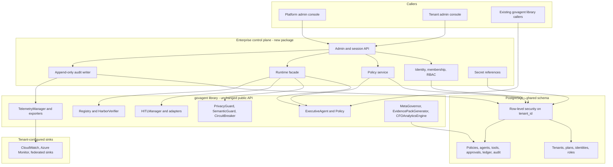
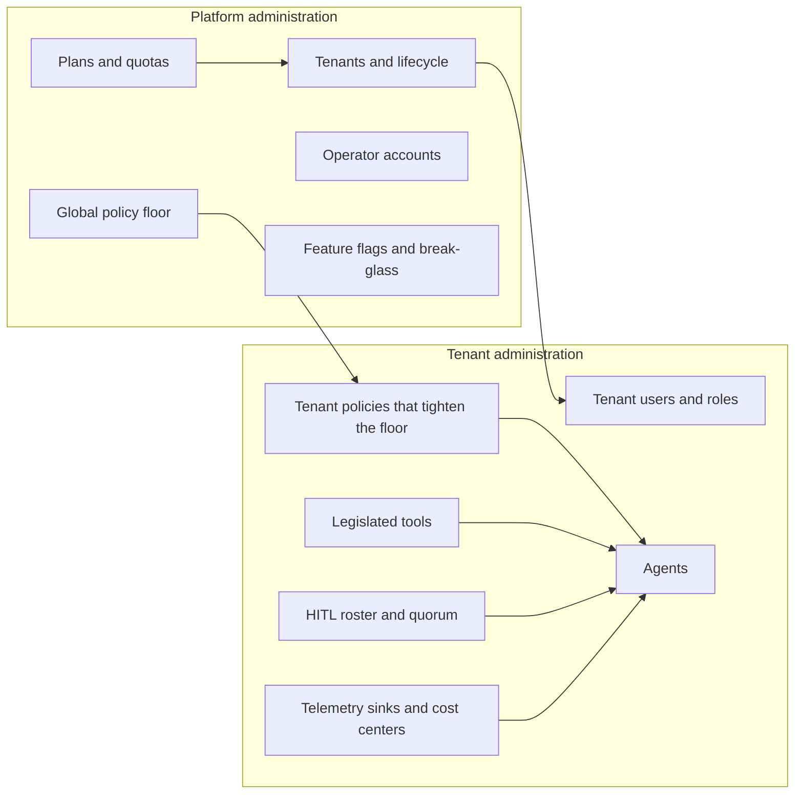
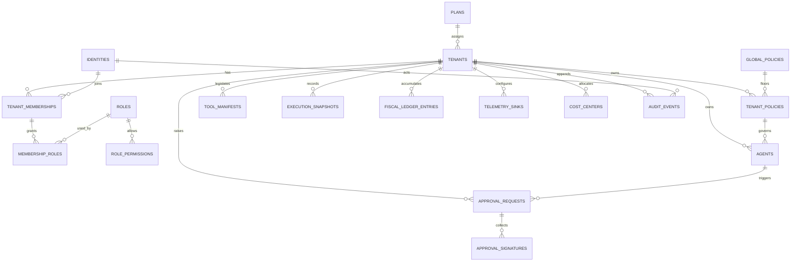

# GovAgent enterprise target architecture

> The control plane is no longer in this public repository. `govagent-platform` is at https://github.com/thekakodkar/govagent-platform. These diagrams are the Phase 0 proposal.

These diagrams are the Phase 0 proposal. They describe a control plane that calls the existing `govagent` library. They do not replace that library.

## Runtime and administration



## Platform administration and tenant administration



## Request isolation

```mermaid
sequenceDiagram
  participant Client
  participant API as Control plane API
  participant DB as PostgreSQL
  participant Lib as govagent library

  Client->>API: Authenticated request
  API->>API: Resolve actor scope and tenant membership
  API->>DB: BEGIN; SET LOCAL app.actor_scope; SET LOCAL app.tenant_id
  DB->>DB: RLS allows only that tenant_id
  API->>Lib: Construct Policy, guards, and agent for this request
  Lib-->>API: Evaluation or snapshot
  API->>DB: Insert audit_events and ledger rows
  API->>DB: COMMIT
  API-->>Client: Response scoped to the tenant
```

## Logical data model


